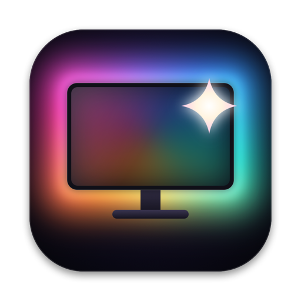

<p align="center">
  
</p>

<h1 align="center">Blask Sync</h1>

<p align="center">Philips Hue sync for your Mac's screen and music</p>

<p align="center"><a href="https://blask.miron.asia/">Website</a> · <a href="https://github.com/mironiasty/blask-sync/releases/latest">Download</a></p>


A menu bar app that syncs Philips Hue lights with your screen, like an ambilight, or with the music your
Mac plays: strips behind the monitor follow its edges or ripple with the beat, and lamps around it pick up the
mood.

**Status:** bridge discovery and pairing, screen sync, music sync and manual light control over the Hue
Entertainment streaming API.

## Requirements

- macOS 14.2+
- Xcode 26+ (the Command Line Tools alone lack the SwiftUI macro plugin)
- A Hue Bridge v2/Pro with an entertainment area set up in the Hue app

## Build & run

```sh
swift test             # unit tests
scripts/bundle.sh      # builds and signs build/BlaskSync.app
open build/BlaskSync.app
```

### Installing a release

Download `BlaskSync-vX.Y.Z.zip` from [Releases](https://github.com/mironiasty/blask-sync/releases), unzip it
and move **BlaskSync.app** to Applications. Release builds are signed with a self-signed certificate, not
notarized, so macOS blocks the first launch; clear the download quarantine once:

```sh
xattr -dr com.apple.quarantine /Applications/BlaskSync.app
```

(or try opening it, then click **Open Anyway** in System Settings → Privacy & Security). Every release is
signed with the same certificate, so Screen Recording carries over when updating.

### Making a release

Push a version tag; the [Release workflow](.github/workflows/release.yml) runs the tests, builds a universal
(Apple Silicon + Intel) app stamped with that version, and publishes it as a GitHub release. It signs with the certificate in the `SIGNING_P12` (base64 `.p12`) and
`SIGNING_P12_PASSWORD` repository secrets:

```sh
git tag v0.1.0 && git push origin v0.1.0
```

### Signing

macOS ties the Screen Recording permission to the app's code signature. `scripts/bundle.sh` signs with `SIGN_IDENTITY` if set, else the first
"Apple Development" certificate, else ad hoc.

- **With a certificate** (add your Apple ID in Xcode → Settings → Accounts → Manage Certificates → Apple
  Development), the permissions survive rebuilds.
- **Ad hoc**, every rebuild is a new app to macOS: Screen Recording has to be granted again.

If `security find-identity -v -p codesigning` lists no valid identity even though Xcode created a
certificate, install Apple's [WWDR G3 intermediate](https://www.apple.com/certificateauthority/AppleWWDRCAG3.cer).

## Using it

- **Menu bar.** If no bridge is paired, **Pair Bridge…** opens Settings. Once paired, the panel shows the
  default area's status, a **Screen / Music / Manual** choice, **Start Sync / Stop Sync** and **Turn Lights Off / On**
  (really switches the area's lights, stopping any sync first; On shows your last manual colors, set directly
  on the lights so they stay after quitting, with gradient strips getting a gradient of their segment colors). Picking Screen or Music
  while in Manual hands the lights straight back to that sync. The icon (a monitor with a
  sparkle) fills in while the lights are driven.
- **Settings (⌘,)**
  - **General:** bridge discovery, pairing and forgetting, the default entertainment area, and whether the
    lights turn off when sync stops (instead of returning to how they were).
  - **Screen:** the mapping canvas and an inspector with Capture (display, intensity), Color (brightness,
    saturation boost, minimum brightness), the channel list and the selected channel's details. Settings doesn't capture the screen:
    the monitor shows the live picture only while screen sync runs.
  - **Music:** palette, intensity and brightness, with live level/bass/mid/high meters, a beat indicator and
    the colors being sent.
- **Manual Control window.** A color wheel with a pin per light (drag a pin to recolor it; selected lights turn
  together), a lights panel (the strip as a segmented LED bar plus lamp bulbs) to choose what to edit, a
  brightness bar, and scenes (warm/neutral/cool whites, off, or a palette spread across the strip). Opening it
  switches the lights to these colors and starts streaming if needed. The colors are remembered per area. Closing it returns to screen sync if that was running, otherwise it releases the lights.

While Settings or Manual Control is open, Blask Sync shows in the Dock and ⌘-Tab (so a window that went
behind others can be brought back); with them closed it's menu-bar-only again. The sync session belongs to
the app, not to a window, so sync keeps running with all windows closed.

## Screen sync

- **Capture.** ScreenCaptureKit streams the chosen display at 160 px wide and up to 60 fps
  (`SyncCore/ScreenCapture.swift`). Blask Sync's own windows are left out, so the editor doesn't sample
  itself. Frames only arrive when the picture changes.
- **Protected video.** While a display is being captured, macOS hides DRM-protected video on the screen
  itself, so the Apple TV app wouldn't play movies at all. With **Pause for Apple TV app** (on by default),
  capture stops while the TV app is in front and the lights ease to a soft warm glow; it resumes when you
  switch away. The TV app is also left out of the capture filter. Lights can't follow protected movies.
  DRM video in a browser (e.g. Netflix in Safari) has the same limitation.
- **Mapping.** The canvas shows the monitor (with the live preview) on the wall, lit by your lights: each one
  is a glowing marker that casts its color onto the wall. Drag a light to move it; hover to see the screen
  area it follows, select it to resize that area. With **Identify while moving** (on by default), the real lights take
  the colors shown on the canvas (one distinct hue per light), with the light you move or select bright and
  the others dim; if sync is off, the lights are taken over just for
  this, without capturing the screen, and released when you leave the tab.
  - **Strip segments** are numbered dots joined by a glowing LED line, and stay on the screen.
  - **Lamps** are bulbs with their icon and can sit on the screen or on the wall beside it. A lamp beside the
    screen samples the nearest same-size screen area, and blends toward the whole screen's average the
    further its center lies outside (1.2 × the distance in screen widths, capped at 80%).

  Defaults project positions from the entertainment area: strip segments onto the nearest screen edge, and
  lamps relative to the strip's extent, so a lamp outside the strip lands beside the screen. Layouts are
  saved per area; **Reset Layout** restores the defaults.
- **Colors.** `ColorExtractor` averages each region. `ColorAdjustment` then applies the **saturation boost**
  (averages drift toward gray; this restores vividness, keeping hue and brightness) and the **minimum
  brightness** (dark scenes glow faintly instead of switching off).
- **Smoothing.** `ScreenSyncEngine` eases toward the latest colors at 50 Hz through two exponential stages,
  an ease-in/ease-out curve rather than a jolt. **Intensity** sets the average delay: subtle 0.6 s,
  moderate 0.3 s, high 0.18 s, extreme 0.1 s. Even Extreme covers the usual gap between captured frames, and
  easing continues while the screen is static.

The first time, macOS asks for **Screen Recording** permission, and the app has to be relaunched after you
allow it.

## Music sync

- **Capture.** A Core Audio process tap (`SyncCore/SystemAudioTap.swift`, macOS 14.2+) records everything the
  Mac plays, without a virtual audio driver and without capturing the display, so it can run while the
  Apple TV app plays a movie. macOS asks for **System Audio Recording** permission; if it's denied, the tap
  delivers silence and the meters stay still.
- **Analysis.** `AudioAnalyzer` runs a 1024-sample FFT (Accelerate) every ~11 ms: loudness and bass
  (20-150 Hz) / mid (150-2000 Hz) / high (2-10 kHz) levels, each auto-gained against its own recent peak,
  and beats when bass energy jumps 1.45× over its 0.5 s average (at least 0.25 s apart).
- **Lights.** `MusicVisualizer` colors from a palette (Vivid, Sunset, Ocean, Party) in one of two styles:
  - **Flow** (default): the palette flows along the strip as a gradient, faster as the music gets louder.
    Beats travel as soft brightness waves from the middle of the strip to its ends, swelling and fading over
    about a second; lamps breathe with the energy and bass. Brightness rises over ~0.3 s and falls over
    ~1 s, and a final smoothing pass keeps every step between updates tiny (≈0.04, versus ≈0.78 in Pulse).
  - **Pulse:** the palette steps to its next color on every beat, with a brightness flash that decays.

  **Intensity** sets how lively Flow moves, or how hard Pulse hits. Silence settles to a soft glow.

## Under the hood

### Pairing

1. Discovery browses `_hue._tcp` over mDNS, with `discovery.meethue.com` as a fallback. You can also enter an IP.
2. **Pair** POSTs `{"devicetype": "blask-sync#<host>", "generateclientkey": true}` to `/api` every 2 s for
   30 s while you press the bridge's link button.
3. The returned `username` (the CLIP v2 application key) and `clientkey` (the DTLS PSK for streaming) go into
   `~/Library/Application Support/BlaskSync/bridge.json`, readable only by your user. A file rather than the
   Keychain, so builds signed differently (local and release) share the pairing without password prompts.

The bridge's certificate is issued by Signify's private CA. The app accepts it only when its common name
equals the bridge ID. If the bridge gets a new IP from DHCP, the app finds it again by ID.

Right after launch, macOS can briefly block local network access ("Local network prohibited", reported as
error -1009 "offline"). Loading areas retries with backoff before reporting an error.

### Strips and lamps

`ChannelDescription` classifies channels from the bridge's own data: a light whose `entertainment` service
has more than one segment is a gradient strip, and each channel member's `index` is its segment. Everything
else is a lamp, with its archetype (`table_shade`, `hue_play`, …) picking the icon.

### Streaming

1. Starting sends `PUT /clip/v2/resource/entertainment_configuration/{id}` with `{"action": "start"}`, then
   opens a DTLS 1.2 PSK session (`TLS_PSK_WITH_AES_128_GCM_SHA256`) to UDP port 2100. The PSK identity is the
   application key and the key is the hex-decoded client key.
2. Each channel's RGB color goes out as a HueStream v2 message at 50 Hz (`HueKit/EntertainmentStream.swift`).
   Nothing is sent until there are real colors, so the lights keep their state instead of flashing a
   placeholder. Capture starts while the stream connects.
3. Stopping, or any graceful quit (menu, logout, shutdown, relaunch), sends `{"action": "stop"}` first, with a
   2 s cap. The lights then return to their previous state. Without it, the bridge ends the session after
   about 10 s without packets.
4. While streaming or capturing, the app holds a latency-critical activity so App Nap doesn't throttle its timers.

## Troubleshooting

Diagnostics go to the unified log under the `local.blasksync` subsystem (zsh has a `log` builtin, so use the
full path):

```sh
/usr/bin/log show --last 10m --style compact --predicate 'subsystem == "local.blasksync"'
```

| Category | Every 5 s / on event |
|---|---|
| `stream` | packets sent to the bridge: rate and largest gap (expect 50/s, no gaps over 50 ms) |
| `screen-sync` | smoothing ticks and captured frames |
| `capture` | ScreenCaptureKit buffers by status (`complete` / `idle` / …) and nearly black frames |
| `bridge` | area loading retries |
| `audio` | audio tap start and peak level (permanently "silent" while music plays = no permission) |

- **"Can't reach the Hue Bridge":** check that the Mac is on the bridge's network and that Blask Sync is
  allowed in System Settings → Privacy & Security → Local Network.
- **Lights hold a color, then jump:** compare against App Nap with
  `defaults write local.blasksync.BlaskSync sync.allowAppNap -bool YES` (delete the key to restore).

## Layout

| Path | What |
|---|---|
| `Sources/HueKit` | Hue protocol: discovery, pairing, CLIP v2, credential storage, strip/lamp classification, DTLS streaming |
| `Sources/SyncCore` | Screen and audio capture, screen mapping, color extraction, smoothing, audio analysis and the music visualizer. No UI code |
| `Sources/BlaskSync` | The SwiftUI menu bar app, Settings and Manual Control windows |
| `Tests/` | Unit tests for `HueKit` and `SyncCore` |
| `Resources/` | `Info.plist` (LSUIElement, local network usage, Bonjour service) and `AppIcon.icns` |
| `scripts/` | `bundle.sh` (build, bundle, sign), `make-icon.swift` and `make-icns.sh` (app icon) |

## App icon

`scripts/make-icon.swift` draws the icon (a monitor with a spectrum halo and a sparkle) with CoreGraphics.
`scripts/make-icns.sh` renders it at every macOS size into `Resources/AppIcon.icns`, which `bundle.sh` copies
into the app, and writes `docs/icon.png` for this README. The menu bar icon is drawn in code in `Sources/BlaskSync/MenuBarIcon.swift`.
